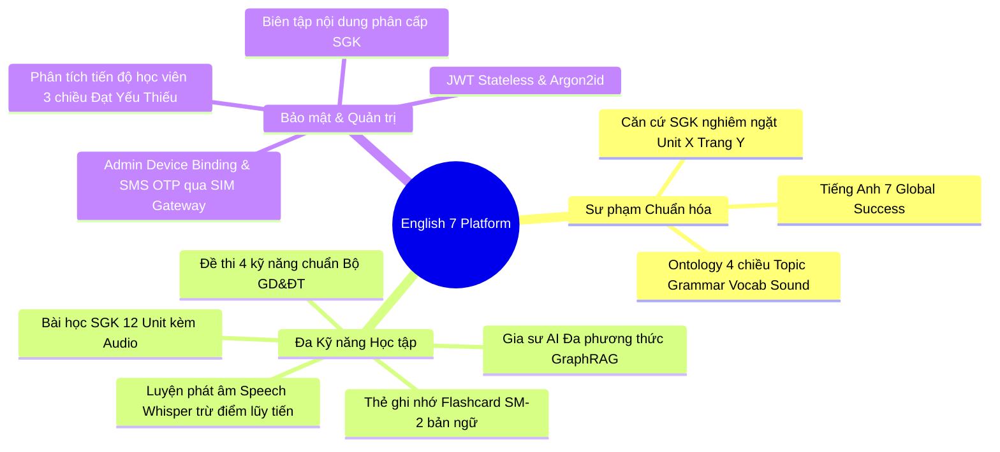
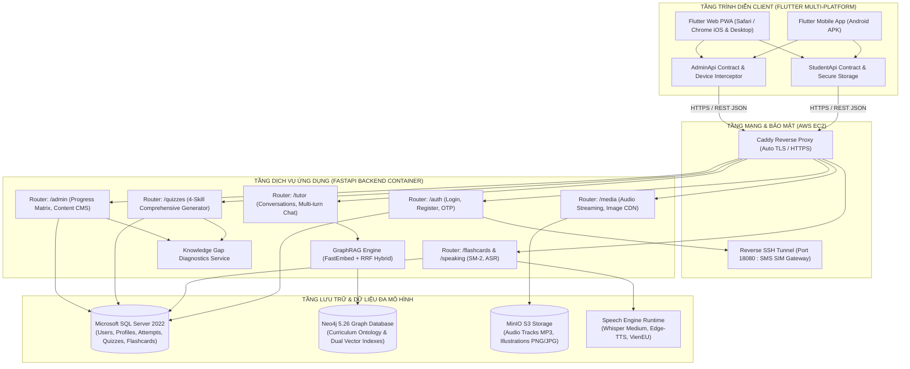
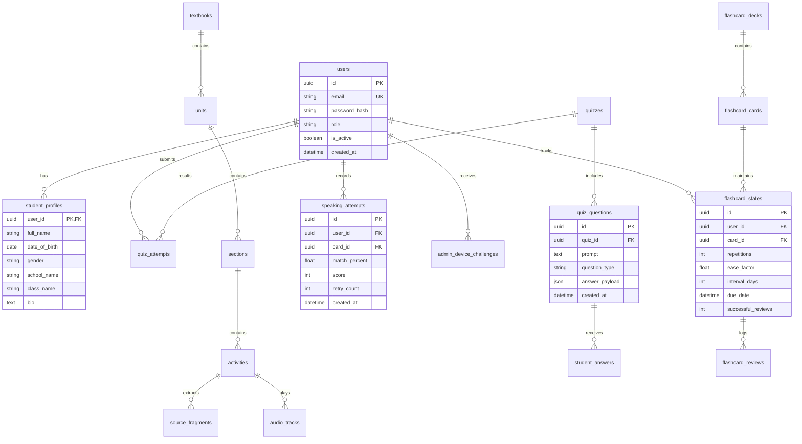
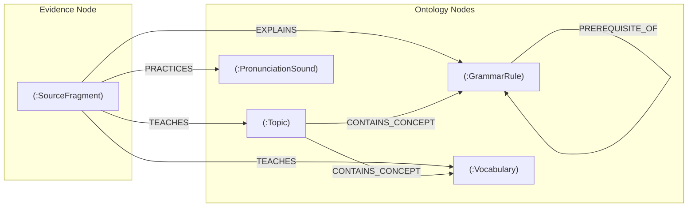

# English 7 Grounded Learning Platform — Tài liệu Phân tích & Thiết kế Hệ thống Toàn diện (DESIGN.md)

> **Dự án**: Nền tảng Học tập Tiếng Anh 7 Có Căn Cứ Sư Phạm & Trợ Giảng AI (*English 7 Grounded Learning Platform*)  
> **Chương trình chuẩn hóa**: Bộ Giáo dục và Đào tạo Việt Nam — *Tiếng Anh 7 Global Success*  
> **Phiên bản tài liệu**: 2.5 (Cập nhật toàn diện kiến trúc, 4 kỹ năng kiểm tra, luyện nói, flashcard và quản trị tiến độ)  
> **Ngày cập nhật**: 29/10/2026

---

## 1. TỔNG QUAN DỰ ÁN & SỨ MỆNH CỐT LÕI (PROJECT OVERVIEW & CORE PRINCIPLES)

English 7 Grounded Learning Platform là một hệ sinh thái giáo dục công nghệ cao kết hợp giữa ứng dụng di động đa nền tảng (Flutter Mobile/PWA) và hệ thống Backend trí tuệ nhân tạo (FastAPI, GraphRAG, Neo4j, SQL Server, MinIO, Speech AI). Mục tiêu của dự án là cung cấp cho học sinh lớp 7 một môi trường tự học tiếng Anh toàn diện, chuẩn xác và an toàn tuyệt đối về mặt sư phạm.



### 3 Nguyên tắc Sư phạm & Kỹ thuật Bất biến:
1. **Grounded Pedagogical Safety (Căn cứ sư phạm tuyệt đối)**: Mọi lời giải thích của Gia sư AI, câu hỏi trắc nghiệm hay gợi ý luyện tập phải có bằng chứng đối soát trực tiếp từ sách giáo khoa (*Tiếng Anh 7 Global Success*, Học kỳ 1 và Học kỳ 2). Hệ thống tuyệt đối không sinh nội dung tự do hay suy diễn ngoài chương trình chuẩn.
2. **Clean Architecture & Domain Isolation (Kiến trúc sạch)**: Tách biệt triệt để giữa tầng Domain (Curriculum Ontology), Application Services (Retrieval, Quiz, Flashcard, Speaking, Tutor, Admin), Presentation (FastAPI Routers, Flutter BLoC/Providers) và Infrastructure (SQL Server, Neo4j, MinIO, Speech Engine).
3. **Responsive Multi-modal Learning (Học tập tương tác đa phương thức)**: Đồng bộ liền mạch giữa Văn bản (Text), Giọng đọc bản ngữ (Edge-TTS & VienEU), Giọng nói học sinh (Whisper ASR), Hình ảnh bài tập chụp từ camera và Biểu đồ radar năng lực.

---

## 2. KIẾN TRÚC TỔNG THỂ HỆ THỐNG (SYSTEM ARCHITECTURE)

Hệ thống được tổ chức theo mô hình phân tầng hướng dịch vụ kết hợp Micro-services cục bộ:



---

## 3. PHÂN TÍCH CHI TIẾT CÁC PHÂN HỆ BACKEND (`backend/src/english7/`)

### 3.1. Phân hệ Xác thực & Bảo mật (`modules/auth/`)
* **Mã hóa mật khẩu**: Sử dụng giải thuật hiện đại **Argon2id** (`argon2-cffi`) chống tấn công brute-force và rainbow table trên GPU.
* **Token Stateless**: Cấp phát JSON Web Token (JWT) có chữ ký số bí mật (`HS256`), thời hạn sống có thể cấu hình, chứa Claims định danh `user_id`, `email`, `role` (`student`, `admin`).
* **Admin Device Binding & SMS OTP qua SIM Gateway**:
  * Tài khoản Quản trị viên (Admin) áp dụng chính sách Zero-Trust: Khi đăng nhập từ một thiết bị mới, hệ thống kích hoạt thử thách thiết bị (`AdminDeviceChallenge`).
  * Mã OTP 6 số ngẫu nhiên được gửi trực tiếp đến số điện thoại di động của Admin thông qua **Reverse SSH Tunnel** kết nối từ máy chủ EC2 (`0.0.0.0:18080`) về dịch vụ SIM Gateway trên điện thoại Android vật lý của quản trị viên (dự phòng qua ClickSend API).
* **Quản lý Hồ sơ Cá nhân (`student_profiles`)**: Lưu trữ họ tên, ngày sinh, giới tính, tên trường, khối lớp và tiểu sử của học sinh.

### 3.2. Phân hệ Đồ thị Tri thức Sư phạm & GraphRAG (`modules/knowledge/` & `modules/retrieval/`)
* **Curriculum Ontology (Bản thể học chương trình 4 lớp)**:
  1. `Topic`: Chủ đề lớn của từng Unit (ví dụ: *Unit 1: Hobbies*, *Unit 7: Traffic*, *Unit 11: Travelling in the future*).
  2. `GrammarRule`: Quy tắc ngữ pháp (Hiện tại đơn, Quá khứ đơn, Động từ tình thái `should/shouldn't`, Từ chỉ số lượng `some/any`, v.v.).
  3. `Vocabulary`: Từ vựng với đầy đủ từ loại (`pos`), phiên âm IPA chuẩn quốc tế và định nghĩa tiếng Việt.
  4. `PronunciationSound`: Cặp âm ngữ âm trọng tâm (`/ə/` và `/ɜː/`, `/e/` và `/æ/`, phát âm đuôi `-ed`, đuôi `-s/-es`).
* **Hệ thống liên kết tri thức (Graph Relationships)**:
  * `(SourceFragment)-[:TEACHES]->(Concept)`: Đoạn trích SGK trực tiếp giảng dạy kiến thức.
  * `(SourceFragment)-[:EXPLAINS]->(Concept)`: Đoạn trích cung cấp ví dụ và quy tắc ngữ pháp.
  * `(SourceFragment)-[:PRACTICES]->(Concept)`: Bài tập rèn luyện kỹ năng tương ứng.
  * `(GrammarRule)-[:PREREQUISITE_OF]->(GrammarRule)`: Quan hệ phụ thuộc tiên quyết giữa các điểm kiến thức.
* **Cơ chế Truy xuất Lai (Hybrid Retrieval & Reciprocal Rank Fusion - RRF)**:
  * **Vector hóa (Embedding)**: Chạy mô hình cục bộ `BAAI/bge-small-en-v1.5` qua thư viện `FastEmbed` (384 chiều, siêu nhẹ, không phụ thuộc API bên thứ ba).
  * **Dual Vector Index trong Neo4j**: Tìm kiếm đồng thời trên `source_fragment_embedding` và `knowledge_concept_embedding`.
  * **Multi-hop Graph Expansion**: Từ các node tìm được qua vector, mở rộng 1-2 bước trên đồ thị để thu thập ngữ cảnh liên quan (quy tắc ngữ pháp tiên quyết, từ vựng liên quan).
  * **Hợp nhất xếp hạng RRF**:
    $$RRF\_Score(d) = \sum_{m \in M} \frac{1}{k + r_m(d)} \quad (k=60)$$
  * **Grounded Citation Guard**: Lọc toàn bộ ứng viên chưa được duyệt (`review_status != 'verified'`), loại bỏ ảnh fallback sai ngữ cảnh, đảm bảo câu trả lời luôn chứa trích dẫn `[Unit X, Trang Y]`.

### 3.3. Phân hệ Gia sư AI Trò chuyện (`modules/tutor/`)
* **Multi-turn Memory**: Duy trì ngữ cảnh hội thoại nhiều lượt (`TutorConversation`, `TutorExchange`), tự động giới hạn độ dài phiên và tóm tắt chủ đề.
* **Xử lý Đa phương thức (Vision & Text)**: Học sinh có thể tải ảnh bài tập chụp từ điện thoại lên MinIO, hệ thống phân tích hình ảnh và trả lời giải thích sư phạm từng bước.
* **Mô hình AI**: Kết nối linh hoạt qua OpenRouter với các mô hình suy luận sư phạm hàng đầu (DeepSeek-R1, Gemini 2.0 Flash, Claude 3.5 Sonnet, Llama 3.3).

### 3.4. Phân hệ Đề thi Tổng hợp 4 Kỹ năng Chuẩn Bộ GD&ĐT (`modules/quizzes/`)
Được thiết kế mô phỏng 100% cấu trúc đề thi chính thức của Bộ Giáo dục & Đào tạo Việt Nam:
* **PHẦN A. KỸ NĂNG NGHE (LISTENING)**:
  * Trình phát file nghe MP3 kèm tên bài nghe (`Unit X: ... (Track Y)`).
  * Giới hạn số lượt nghe (mặc định 2 lượt) để rèn luyện kỹ năng nghe nghiêm túc.
  * Dạng câu hỏi nhận định: True / False / Not given.
* **PHẦN B. NGỮ ÂM & NGÔN NGỮ (LANGUAGE FOCUS)**:
  * **Phát âm (Pronunciation)**: Chọn từ có phần gạch chân phát âm khác biệt (âm nguyên âm, phụ âm, quy tắc đọc đuôi `-ed`, đuôi `-s/-es`).
  * **Trọng âm (Primary Stress)**: Chọn từ có vị trí trọng âm khác (từ 2 âm tiết, từ 3 âm tiết).
  * **Ngữ pháp & Từ vựng (Vocabulary & Grammar)**: Trắc nghiệm 4 lựa chọn (A, B, C, D) điền khuyết câu.
* **PHẦN C. ĐỌC HIỂU (READING)**:
  * **Trích dẫn toàn văn bài đọc (Reading Passage)** đóng khung trang trọng, có bản quyền trích dẫn *(Adapted from Tiếng Anh 7 Global Success)*:
    1. *FUTURE MEANS OF TRANSPORT (Unit 11)*: Đoạn văn về xe tự lái (`driverless car`), người đi bộ sang đường (`pedestrians`), máy bay cá nhân (`bamboo-copter`).
    2. *ALASKA - THE AMAZING STATE (Unit 12)*: Đoạn văn về kỳ quan thiên nhiên, hồ nước, chó kéo xe và năng lượng sạch.
    3. *PORTOBELLO MARKET IN LONDON (Review 4 / Culture)*: Đoạn văn về chợ Portobello, đồ cổ và văn hóa đường phố London.
  * **Hệ thống câu hỏi nằm ngay dưới bài đọc**: Gồm câu hỏi trắc nghiệm A, B, C, D và nhận định True / False / Not given bám sát đoạn văn.
* **PHẦN D. KỸ NĂNG VIẾT (WRITING)**:
  * **Sắp xếp câu (Sentence Reordering)**: Chọn trắc nghiệm câu hoàn chỉnh nhất được tạo từ các cụm từ xáo trộn cho trước.
  * **Tìm lỗi sai (Error Identification & Correction)**: Chọn phần gạch chân (A, B, C hoặc D) bị sai ngữ pháp/từ vựng trong câu.
* **Quản lý thời gian linh hoạt**: Cho phép chọn preset (15 phút, 45 phút, 60 phút) hoặc tùy chỉnh từ 10 đến 90 phút qua Popup chọn giờ trực quan.

### 3.5. Phân hệ Luyện Từ vựng Flashcard SM-2 (`modules/flashcards/`)
* **Thuật toán Spaced Repetition (SuperMemo-2)**:
  * Tính toán chu kỳ lặp lại tối ưu dựa trên điểm đánh giá nhớ của học sinh (1: Chưa nhớ ➔ 5: Rất nhớ).
  * Các biến số: Số lần ôn (`repetitions`), Hệ số dễ (`ease_factor`), Khoảng cách ngày ôn kế tiếp (`interval_days`), Ngày đến hạn (`due_date`).
  * Phân loại trạng thái: Thẻ đã thuộc (`mastered` khi review thành công $\ge 2$ lần), Thẻ đến hạn (`due`), Thẻ khó (`difficult`).
* **Phát âm Đa ngôn ngữ**:
  * Phát âm tiếng Anh chuẩn bản ngữ qua **Edge-TTS** (`en-US-JennyNeural`, `en-US-GuyNeural`).
  * Phát âm tiếng Việt hỗ trợ nghĩa từ vựng qua **VienEU TTS**.

### 3.6. Phân hệ Luyện Nói & Đánh giá Phát âm (`modules/speaking/`)
* **Speech-to-Text & Chấm điểm âm thanh**:
  * Thu âm giọng đọc câu của học sinh, gửi về backend Speech Runtime chạy mô hình Whisper.
  * Đo lường tỷ lệ trùng khớp (`match_percent`) so với câu mẫu SGK.
* **Cơ chế Đo lường Thật & Trừ điểm Lũy tiến**:
  * Học sinh nói đúng ngay lần đầu: Đạt trọn vẹn điểm (100%).
  * Nếu phát âm sai: Hệ thống cho phép thử lại tối đa **5 lần**, điểm số giảm dần sau mỗi lần thử sai.
  * Nếu sai quá 5 lần: Nút **"Bỏ qua"** xuất hiện; nếu học sinh bấm bỏ qua, câu đó ghi nhận 0 điểm để đánh giá đúng thực chất năng lực.
* **Lưu vết và Khôi phục phiên học (Session Persistence & Resume)**:
  * Toàn bộ tiến trình làm bài được tự động lưu vào bộ nhớ cục bộ (`PracticeSessionStore`).
  * Khi học sinh vô tình thoát ra giữa chừng và vào lại, ứng dụng hiển thị hộp thoại xác nhận:
    * **"Tiếp tục"**: Giữ nguyên vị trí câu và điểm số đang làm.
    * **"Bắt đầu lại"**: Xóa phiên cũ và luyện tập lại từ đầu.

### 3.7. Phân hệ Chẩn đoán Lỗ hổng Kiến thức & Quản trị Admin (`modules/attempts/` & `modules/admin/`)
* **Radar Chẩn đoán Lỗ hổng (`KnowledgeGapService`)**:
  * Tổng hợp lịch sử làm bài kiểm tra (`TestAttempt`, `StudentAnswer`), ôn flashcard và luyện nói.
  * Xác định các khái niệm bị hổng (tỷ lệ sai $> 40\%$, điểm thành thạo $< 60\%$), liên kết trực tiếp với Unit và trang SGK.
* **Bảng Đánh giá Năng lực Học sinh 3 Trạng thái cho Admin**:
  * Thay thế tỷ lệ phần trăm đơn điệu bằng ma trận phân tích 4 kỹ năng (*Nghe, Ngôn ngữ, Đọc, Viết*):
  * **🟢 ĐÃ MASTER / ĐẠT CHUẨN (Thành thạo)**:
    * Kỹ năng đạt điểm $\ge 80\%$.
    * Unit hoàn thành xuất sắc.
    * Thẻ từ vựng thuộc vững ($\ge 2$ lần ôn đúng liên tiếp).
    * Câu luyện nói phát âm tốt ($\ge 85\%$).
  * **🟠 ĐANG YẾU / CẦN CỦNG CỐ (Lỗ hổng kiến thức)**:
    * Kỹ năng có điểm $< 70\%$.
    * Các điểm ngữ pháp học sinh hay làm sai trong bài kiểm tra.
    * Thẻ từ vựng bị đánh dấu khó hoặc quên nhiều lần.
    * Câu luyện nói điểm phát âm thấp ($< 60\%$).
  * **⚪ ĐANG THIẾU / CHƯA HỌC (Cần can thiệp)**:
    * Kỹ năng chưa từng làm bài kiểm tra.
    * Các Unit chưa từng học trong tổng số 12 Unit SGK.
    * Hoạt động từ vựng hoặc luyện nói chưa thực hiện.

---

## 4. THIẾT KẾ CƠ SỞ DỮ LIỆU TOÀN DIỆN (DATA SCHEMAS)

### 4.1. Sơ đồ Quan hệ SQL Server (Entity-Relationship)



### 4.2. Sơ đồ Đồ thị Tri thức Neo4j (Graph Schema)



---

## 5. THIẾT KẾ GIAO DIỆN CLIENT MOBILE & WEB PWA (`mobile/lib/`)

### 5.1. Hệ thống Design Tokens

| Token Name | Hex Code | Ứng dụng trên Giao diện |
| :--- | :--- | :--- |
| **Primary Brand** | `#4F46E5` / `#6366F1` | Thanh điều hướng, nút Nộp bài, Exam Header |
| **Secondary Accent** | `#0D9488` / `#14B8A6` | Huy hiệu câu Sắp xếp từ, điểm số thành thạo |
| **Success Emerald** | `#16A34A` / `#DCFCE7` | Huy hiệu ĐÃ MASTER, câu trả lời đúng, thẻ đã thuộc |
| **Warning Amber** | `#D97706` / `#FEF3C7` | Huy hiệu ĐANG YẾU, cảnh báo số lần nói còn lại |
| **Neutral Missing** | `#9CA3AF` / `#F3F4F6` | Huy hiệu ĐANG THIẾU, kỹ năng chưa làm bài |
| **Surface Dark** | `#0F172A` / `#1E293B` | Chữ chính trên nền sáng, đảm bảo chuẩn tương phản cao (WCAG AAA) |

### 5.2. Cấu trúc Thư mục Tính năng Mobile (`mobile/lib/`)
* `lib/app/`: Bootstrap, định tuyến `English7Router`, `StudentApi` & `AdminApi` abstractions.
* `lib/features/auth/`: Đăng nhập, đăng ký, thử thách thiết bị Admin qua OTP SMS.
* `lib/features/lessons/`: 12 Unit học tập SGK, player nghe bài giảng MP3, bài tập tương tác.
* `lib/features/quizzes/`: Màn hình tạo đề thi linh hoạt, màn hình thi 4 phần chuẩn hóa, popup bộ chọn đồng hồ 10-90 phút.
* `lib/features/flashcards/`: Thẻ từ vựng 2 mặt lật 3D, âm thanh TTS bản ngữ, quản lý phiên học dở dang.
* `lib/features/speaking/`: Luyện phát âm câu, ghi âm micro trực tiếp, trừ điểm lũy tiến, tiếp tục phiên.
* `lib/features/progress/`: Bảng theo dõi tiến độ cá nhân & Dashboard quản trị viên bóc tách 4 kỹ năng.
* `lib/features/profile/`: Trang cá nhân học sinh, sửa hồ sơ, đổi mật khẩu.
* `lib/features/admin/`: Shell quản trị, biên tập nội dung bài học, duyệt xuất bản, kiểm tra lịch sử chat học viên.

---

## 6. HẠ TẦNG VẬN HÀNH & TRIỂN KHAI ĐÁM MÂY (DEVOPS & DEPLOYMENT)

### 6.1. Cấu hình Cụm Máy chủ Đám mây AWS EC2
* **Địa chỉ IP máy chủ**: `13.229.72.146` (Region: Singapore `ap-southeast-1`).
* **Hệ điều hành**: Ubuntu 24.04 LTS (x86_64, 4 vCPU, 16GB RAM).
* **Đường dẫn Web PWA chính thức**: [https://13.229.72.146.sslip.io/app/](https://13.229.72.146.sslip.io/app/)
* **Đường dẫn tải file cài đặt Android APK**: [https://13.229.72.146.sslip.io/app/app-debug.apk](https://13.229.72.146.sslip.io/app/app-debug.apk)

### 6.2. Cụm Docker Compose trên EC2

```text
CONTAINER ID   IMAGE                                        PORTS                               NAMES
6bbf9412e271   english7-api:runtime                         127.0.0.1:8000->8000/tcp            english7-api-1
f3fa8e5aa369   english7-worker:vision                       (background worker)                 english7-worker-1
24f6290caf7c   neo4j:5.26-community                         127.0.0.1:7474, 7687/tcp            english7-neo4j-1
a603f2418cad   bitnamilegacy/minio:2025.7.23-debian-12-r3   127.0.0.1:9000, 9001/tcp            english7-minio-1
9d65813e8d89   mcr.microsoft.com/mssql/server:2022-latest   127.0.0.1:1433->1433/tcp            english7-sqlserver-1
adb3b81b4137   english7-speech-runtime                      127.0.0.1:8010->8010/tcp            english7-speech-runtime-1
```

### 6.3. Kiến trúc SMS OTP Gateway
```
[Admin Phone App / Web] 
         │ (Đăng nhập thiết bị mới)
         ▼
[FastAPI /auth/login] ──> Phát sinh AdminDeviceChallenge (OTP 6 số ngẫu nhiên)
         │
         ▼
[HTTP Request tới localhost:18080]
         │
   (Reverse SSH Tunnel: 0.0.0.0:18080 -> 127.0.0.1:8085)
         │
         ▼
[Android Physical Phone SIM Gateway] ──(Sóng Viễn Thông GSM)──> [Admin Phone nhận tin nhắn SMS OTP]
```

---

## 7. CHỈ SỐ CHẤT LƯỢNG MÃ NGUỒN & KIỂM THỬ (QA METRICS)

| Hạng mục kiểm thử | Công cụ | Số lượng Test Cases | Trạng thái |
| :--- | :--- | :--- | :--- |
| **Backend Unit & API Tests** | `pytest` + `coverage` | **299 passed** (15 quiz, 14 flashcard, 16 auth, 10 retrieval, ...) | ✅ 100% Pass |
| **Mobile Flutter Unit & Widget** | `flutter test` | **152 passed** (quiz sections, flashcard mastery, speaking score, admin progress, ...) | ✅ 100% Pass |
| **Phân tích Tĩnh Mobile** | `flutter analyze` | Toàn bộ mã nguồn `mobile/` | ✅ **0 Issue** (No issues found) |
| **Kiểm tra Asset PWA & Caddy** | `scripts/test_pwa_assets.py` | 6 tests | ✅ 100% Pass |
| **Độ phủ Sư phạm SGK** | Neo4j Cypher verification | Đủ 12 Unit SGK Tiếng Anh 7, 48 Sections, >300 Từ vựng, 24 Cặp âm | ✅ Hoàn thành |

---

## 8. LỆNH VẬN HÀNH DÀNH CHO LẬP TRÌNH VIÊN (DEVELOPER COMMANDS)

Tất cả các lệnh quản trị được tự động hóa thông qua `Makefile` tại thư mục gốc:

```bash
# 1. Khởi động môi trường phát triển
make up               # Bật các dịch vụ SQL Server, Neo4j, MinIO, API
make seed             # Nạp dữ liệu SGK và build Knowledge Graph trong Neo4j

# 2. Kiểm thử chất lượng
make test             # Chạy toàn bộ kiểm thử backend và mobile
make test-backend     # Chạy riêng kiểm thử backend pytest
make test-mobile      # Chạy riêng kiểm thử Flutter test
make analyze          # Phân tích tĩnh Flutter analyze (yêu cầu 0 lỗi)

# 3. Build & Triển khai PWA lên EC2
make build-pwa        # Build Flutter Web tối ưu tài nguyên
./scripts/deploy_pwa.sh # Tự động đóng gói, đẩy lên EC2 và reload Caddy

# 4. Sao lưu & Phục hồi CSDL
make backup-db        # Tạo bản sao lưu SQL Server (.bak và .sql) trong backups/
make restore FILE=backups/<ten_file> # Phục hồi dữ liệu
```

---
*Tài liệu này được duy trì và cập nhật tự động theo các tiêu chuẩn kỹ thuật trong [AGENTS.md](file:///home/nguyenphuong/Documents/DoAN_LTDD/AGENTS.md).*
