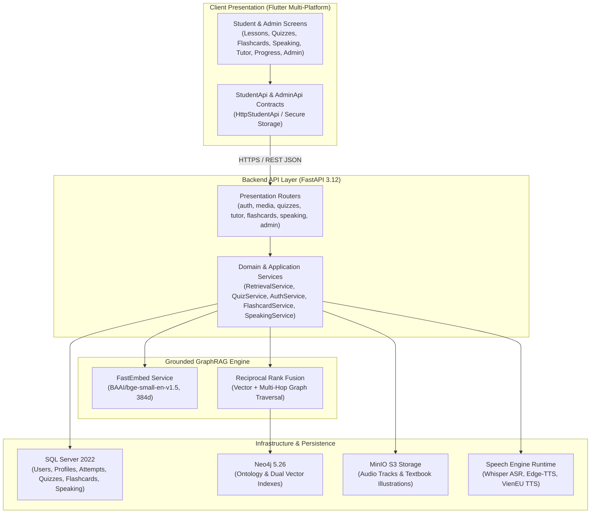

# System Architecture Overview

The **English 7 Grounded Learning Platform** is an educational AI system engineered for Vietnamese Grade 7 English students (*Tiếng Anh 7 Global Success*). It enforces grounded textbook citations, multi-hop pedagogical reasoning, multi-modal learning (Flashcard SM-2, Whisper speech evaluation, 4-skill examinations), and responsive cross-platform delivery (Flutter Android native and Web PWA).

## High-Level Architecture Diagram

## Storage Responsibilities

1. **Microsoft SQL Server 2022**:
   - Manages relational entities: user accounts (`users`), student profiles (`student_profiles`), attempts (`quiz_attempts`, `test_attempts`, `student_answers`), textbook hierarchy, flashcard spaced repetition states (`flashcard_states`, `flashcard_reviews`), speaking pronunciation attempts (`speaking_attempts`), admin device challenges (`admin_device_challenges`), and audit logs.
   - Enforces foreign key constraints and transactional integrity.

2. **Neo4j Graph Database 5.26**:
   - Models curriculum ontology: `Topic`, `GrammarRule`, `Vocabulary`, `PronunciationSound`, and `SourceFragment`.
   - Links nodes with pedagogical relationships (`TEACHES`, `EXPLAINS`, `PRACTICES`, `PREREQUISITE_OF`).
   - Hosts dual vector indexes (`source_fragment_embedding`, `knowledge_concept_embedding`) for hybrid vector + graph traversal.

3. **MinIO Object Storage**:
   - Hosts lesson audio recordings (`.mp3`), student speech recordings, and textbook activity illustrations (`.png`, `.jpg`).
   - Serves assets through streaming endpoints with range request support.

4. **Speech Engine Runtime**:
   - Hosts speech-to-text evaluation models (Whisper) for measuring pronunciation similarity and match percentages.
   - Generates native English pronunciation audio via Edge-TTS and Vietnamese translations via VienEU.

## Multi-Modal Educational Pillars

1. **Grounded AI Tutor**:
   - Multi-turn conversation memory with strict grounded citations (`[Unit X, Page Y]`).
   - Multi-modal support for student-uploaded exercise images.
2. **Standard 4-Skill Examination Engine**:
   - Modeled after official Vietnamese Ministry of Education standardized exams:
     - Section A: Listening (MP3 playback with limited plays count, True/False/Not given).
     - Section B: Language Focus (Pronunciation, primary stress, vocabulary & grammar gap-fill).
     - Section C: Reading Comprehension (Full quoted reading passage followed by questions).
     - Section D: Writing (Sentence reordering and error identification/correction).
   - Adaptive difficulty and 10–90 minute visual timer.
3. **Spaced Repetition Flashcards (SM-2)**:
   - SuperMemo-2 scheduling for optimal memory retention, audio pronunciation, and mastery status.
4. **Pronunciation & Speaking Practice**:
   - Progressive score deduction across retries (up to 5 attempts before skip option).
   - Practice session persistence with seamless resume dialogs.
5. **Admin Progress Matrix**:
   - Skill breakdown across Listening, Language, Reading, and Writing.
   - Three pedagogical categories: Mastered ($\ge 80\%$), Weak ($< 70\%$), and Missing (unattempted units).

## Clean Architecture Guarantees

- Domain models and ontology dataclasses have zero dependencies on web frameworks or databases.
- Repositories encapsulate database drivers; routers only interact through service interfaces.
- AI Tutor answers and quiz questions are verified against grounded retrieved contexts before presentation to students.
- Zero-Trust Admin Authentication enforces device binding and SMS OTP via SIM Gateway reverse tunnel.
